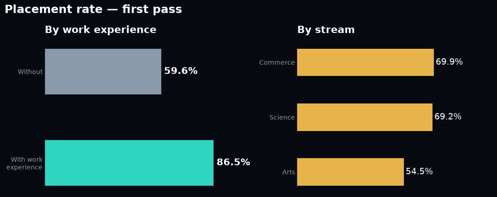
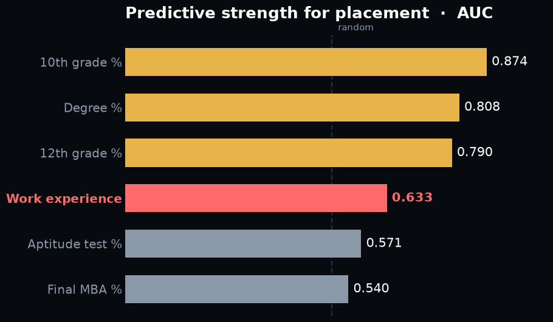
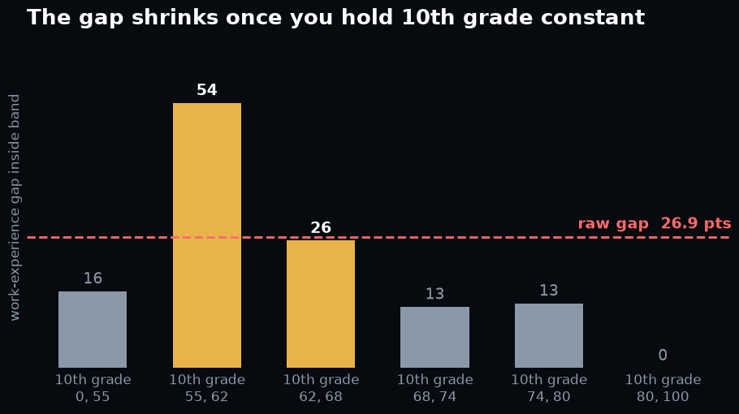
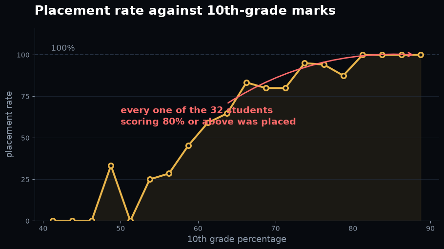
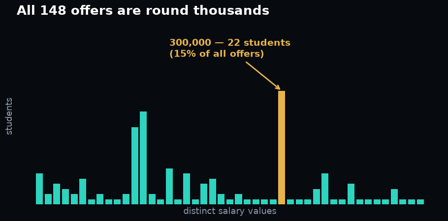

<div align="center">

# College Placement Analysis

### I found a 27-point result, published it, then checked it properly. It was wrong.

Work experience ranked **4th of 6**, not 1st. And the dataset turned out to be
generated — not a record of real students.

`Pandas` · `Matplotlib` · `Seaborn`

</div>

---

## What this is

An exploratory analysis of **215 MBA campus placement records**, done in two halves:

1. **Describe** — what does the data say?
2. **Verify** — was the headline finding correct, and is this even real data?

The second half exists because the first half produced a wrong answer. That is the
actual subject of this project.

**Every figure below is generated by `analysis.ipynb` via `savefig()`, and every number
is printed by a cell in it.** Nothing in this README was typed by hand.

---

## Part 1 — The first pass

| Question | Answer |
|---|---|
| Overall placement rate | **68.8%** |
| With work experience | **86.5%** |
| Without | **59.6%** |
| Gap | **26.9 points** |
| Stream spread (best to worst) | 15.4 points |
| Median salary | ₹2,65,000 |



Read alone, that says work experience dominates: a 27-point gap against a 15-point
spread between streams. **That was the original claim, and it was wrong.**

---

## Part 2 — Verify

### The claim was based on two columns

The first pass compared work experience against **stream** only, then generalised to
"nothing else in this dataset moved the outcome that far." Three academic columns had
never been in the comparison.

### Rank every factor, not two

**AUC** scores how well a column separates placed from not-placed. 0.5 is a coin flip,
1.0 separates perfectly. It is rank-based, so it does not depend on where a threshold is
drawn.



| Rank | Factor | AUC |
|---|---|---|
| 1 | 10th grade % | **0.874** |
| 2 | Degree % | **0.808** |
| 3 | 12th grade % | **0.790** |
| **4** | **Work experience** | **0.633** |
| 5 | Aptitude test % | 0.571 |
| 6 | Final MBA % | 0.540 |

Work experience is **4th**, not 1st. Students in the top half by 10th-grade marks were
placed **90.2%** of the time; the bottom half, **45.6%** — a 44.5-point gap, far larger
than anything work experience does.

### The gap was also confounded

Students with work experience averaged **69.9** in 10th grade against **65.9** for those
without. Some of the 27 points was academic ability showing through. Comparing students
who already scored similarly:



The mean gap within bands falls to **20.4 points** — and in the top band it is **exactly
zero**.

---

## Part 3 — Is this even real data?

Before claiming anything about students, check whether the file behaves like records of
real students. It does not.



**Placement saturates.** All **32** students scoring 80% or above in 10th grade were
placed — no exceptions. Real cohorts always have exceptions at the top; a clean 100%
ceiling is a generation rule.



**Salaries are on a grid.** All **148** offers are exact multiples of ₹1,000, across only
**45 distinct values**. ₹3,00,000 appears 22 times — nearly one student in seven.

**Conclusion:** this is a generated teaching dataset. Neither the placement rate nor the
salary spread in it describes how placement actually works.

---

## What this project is actually about

The finding is not "work experience matters." The finding is **how easily a plausible
number becomes a false claim**, and what it costs to check.

The first pass was not incompetent — the arithmetic was correct, the charts were real,
and the 27-point gap genuinely exists in the data. It was just measured against the
wrong comparison and then stated as a universal. Three cheap checks would have caught it:

- **Compare every column**, not the two that looked interesting
- **Split at the median** as a second opinion, free of arbitrary thresholds
- **Stratify the headline** to see whether it survives holding something else constant

None of that is machine learning. It is the part of analysis that happens before
modelling, and it is the part most often skipped.

---

## The data

215 records, 15 columns, from the [Campus Recruitment dataset][kaggle] by Ben Roshan
(Jain University), sourced from Dr. Dhimant Ganatara. **CC0 — public domain.**

| Column | Meaning |
|---|---|
| `sl_no` | Serial number |
| `gender` | M / F |
| `ssc_p`, `ssc_b` | 10th grade percentage and board |
| `hsc_p`, `hsc_b`, `hsc_s` | 12th grade percentage, board and stream |
| `degree_p`, `degree_t` | Degree percentage and field |
| `workex` | Prior work experience — **Yes / No** |
| `etest_p` | Employability test percentage |
| `specialisation` | MBA specialisation — Mkt&Fin / Mkt&HR |
| `mba_p` | MBA percentage |
| `status` | **Placed / Not Placed** |
| `salary` | Annual salary — blank for unplaced students |

**On salary:** blank for all 67 unplaced students. Expected, not a defect — those rows
are kept, and salary analysis is restricted to the 148 placed students.

**On cleaning:** the cleaning step is defensive. On this dataset `drop_duplicates()`
and `to_numeric()` remove nothing — there are 0 duplicates and `salary` is already
numeric. They stay so the notebook still runs on a revised file.

---

## Setup

```bash
git clone https://github.com/HusainMain/college-placement-analysis.git
cd college-placement-analysis
python -m venv .venv
.venv\Scripts\activate        # Windows
source .venv/bin/activate     # macOS / Linux
pip install -r requirements.txt
```

## Usage

```bash
jupyter nbconvert --to notebook --execute --inplace analysis.ipynb
```

Or open `analysis.ipynb` in JupyterLab / VS Code and run all cells. Must be run from the
repo root — input and output paths are relative to it.

Regenerates `data/cleaned_placement.csv` and all five figures in `images/`.

---

## Project structure

```
.
├── analysis.ipynb      # the analysis — describe, verify, conclude
├── requirements.txt    # pinned dependencies
├── data/
│   ├── placement_raw.csv
│   └── cleaned_placement.csv
├── images/             # figures, regenerated on every run
└── report/             # academic report (PDF + DOCX)
```

---

## Project report

The full academic report is in [`report/`](report/) — PDF and DOCX.

> **Note:** the report was written against an earlier outline and describes a different
> dataset in places — different column count, different salary range, figures that do
> not reconcile. **The notebook and this README are authoritative.** Everything here is
> computed from `data/placement_raw.csv` and can be re-run.

---

## Academic details

| | |
|---|---|
| **Subject** | Python for Data Science (PDS) — `BE05000231` |
| **Course** | BE 3rd Year, Semester 5, Computer Engineering |
| **Project type** | Project-Based Learning / Micro Project |
| **Institution** | Sardar Vallabhbhai Patel Institute of Technology, Vasad |
| **University** | Gujarat Technological University, Chandkheda, Ahmedabad |
| **Department** | Computer Engineering |
| **Submitted by** | Husain Bardanwala (240410107008) |
| **Faculty guide** | Keyur Suthar |
| **Head of Department** | Jayna Shah |
| **Academic year** | 2026 – 2027 |

---

## If you take one thing

A dramatic result is not a verified one. The chart looked right, the code ran clean, and
the number was real — and the claim was still wrong.

---

## Licence

Dataset: CC0 — public domain. Code: see `requirements.txt` for the dependency set.

[kaggle]: https://www.kaggle.com/datasets/benroshan/factors-affecting-campus-placement
