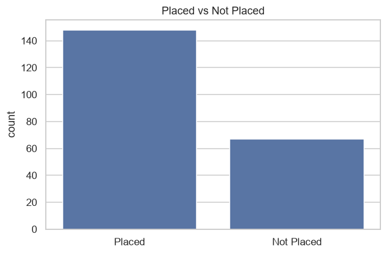
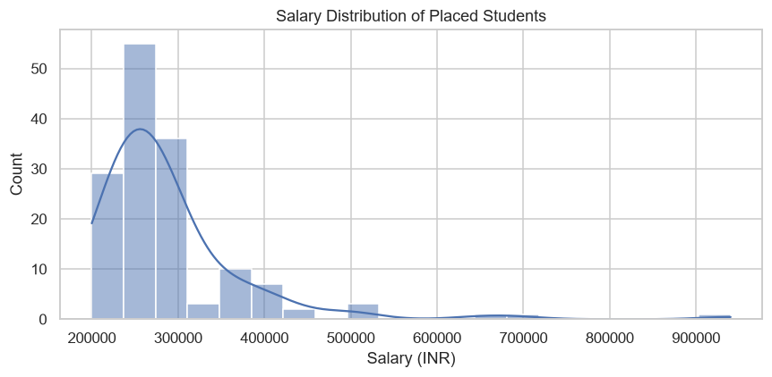
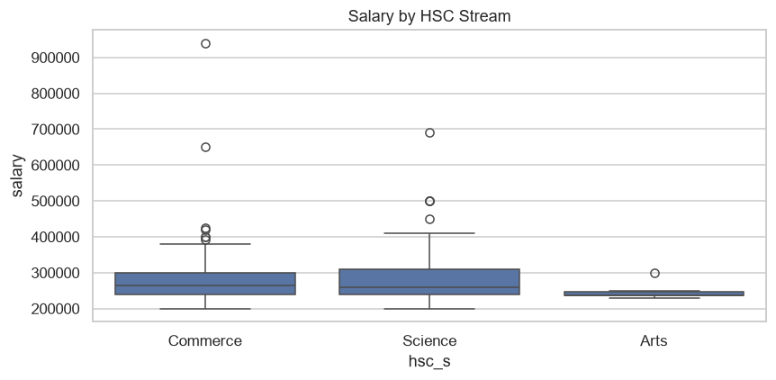
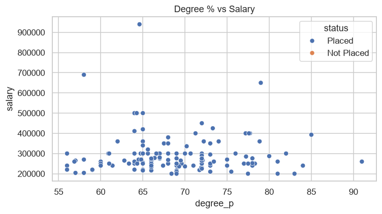

<div align="center">

# College Placement Analysis

### 68.8% of students were placed. The number that actually matters is **27**.

**Work experience took placement from 59.6% to 86.5%.** Nothing else in this dataset —
not a board, not a stream, not five academic scores — moved the outcome that far.

`Pandas` · `Matplotlib` · `Seaborn`

</div>

---

## What this is

An exploratory data analysis of **215 MBA campus placement records**, answering four
questions a placement cell actually asks:

| Question | Answer |
|---|---|
| What is the overall placement rate? | **68.8%** |
| Does work experience change the outcome? | **Yes — 59.6% → 86.5%** |
| How do streams compare? | Commerce **69.9%**, Science **69.2%**, Arts **54.5%** |
| What does the salary structure look like? | Median **₹2,65,000**, right-skewed to ₹9,40,000 |

The workflow is a standard descriptive pipeline:

```
load → inspect → clean → analyse → visualise
```

No machine learning, no databases, no deployment. The goal was to answer the questions
correctly and show the work — **every figure in this README is printed by the last cell
of the notebook**, so the write-up and the code cannot drift apart.

---

## Why it was built

Placement cells collect hundreds of records every year and then leave them in a CSV.
Nobody reads a spreadsheet of 215 rows by eye, and the questions that matter — *what
actually predicts placement, and who is being left behind?* — need the data summarised
and charted before anyone can answer them.

This project was the **case study for the Python for Data Science subject**: take a real
raw CSV, clean it defensively, and turn it into a small set of defensible findings using
nothing but Pandas and two plotting libraries.

It turned out the headline answer was not about academics at all.

---

## The two findings worth your time

**1. Work experience dominates everything else.**

A **~27 percentage point** gap between students who have it and those who do not. For
comparison, the entire spread between the best and worst stream is about 15 points.
Whatever else is true about this cohort, prior work experience is the strongest single
association in the data.

> This is an *association*, not a causal claim — the data is observational and has no
> controls for who chooses to work before campus. It is the strongest signal present,
> not proof of causation.

**2. Salary is right-skewed, so the median is the honest number.**

The mean offer is **₹2,88,655** but the median is **₹2,65,000** — a gap of ~₹23,600,
driven by a thin tail of high offers reaching ₹9,40,000. Quoting the mean alone would
overstate what a typical graduate earns. The standard deviation of **₹93,457** against a
median of ₹2,65,000 says the same thing.

---

## Charts

### Placement status



### Salary distribution — note the right tail



### Salary by stream — Commerce highest, Arts tightest



### Degree percentage vs salary



All four are generated by `fig.savefig()` on every run — nothing here was exported by
hand.

---

## The data

215 records, 15 columns, from the [Campus Recruitment dataset][kaggle] by Ben Roshan
(Jain University), sourced from Dr. Dhimant Ganatara. **CC0 — public domain.**

| Column | Meaning |
|---|---|
| `sl_no` | Serial number |
| `gender` | M / F |
| `ssc_p`, `ssc_b` | 10th grade percentage and board |
| `hsc_p`, `hsc_b`, `hsc_s` | 12th grade percentage, board and stream |
| `degree_p`, `degree_t` | Degree percentage and field |
| `workex` | Prior work experience — **Yes / No** |
| `etest_p` | Employability test percentage |
| `specialisation` | MBA specialisation — Mkt&Fin / Mkt&HR |
| `mba_p` | MBA percentage |
| `status` | **Placed / Not Placed** |
| `salary` | Annual salary — blank for unplaced students |

**One note on the data:** `salary` is blank for all 67 unplaced students. That is
expected, not a defect — so those rows are kept, and all salary analysis is restricted
to the 148 placed students.

**One note on the cleaning:** the cleaning step is *defensive*. On this dataset
`drop_duplicates()` and `to_numeric()` remove nothing — there are **0 duplicates**, no
stray whitespace, and `salary` is already numeric. They stay in the notebook so it still
runs correctly against a revised file.

---

## Setup

```bash
git clone https://github.com/HusainMain/college-placement-analysis.git
cd college-placement-analysis
python -m venv .venv
.venv\Scripts\activate        # Windows
source .venv/bin/activate     # macOS / Linux
pip install -r requirements.txt
```

## Usage

```bash
jupyter nbconvert --to notebook --execute --inplace analysis.ipynb
```

Or open `analysis.ipynb` in JupyterLab / VS Code and run all cells. Must be run from the
repo root — input and output paths are relative to it.

Regenerates `data/cleaned_placement.csv` and all four charts in `images/`.

---

## Project structure

```
.
├── analysis.ipynb      # the analysis
├── requirements.txt    # pinned dependencies
├── data/
│   ├── placement_raw.csv
│   └── cleaned_placement.csv
├── images/             # charts, regenerated on every run
└── report/             # academic report (PDF + DOCX)
```

---

## Project report

The full academic report is in [`report/`](report/) — PDF and DOCX.

> **Note:** the report was written against an earlier outline, and parts of its narrative
> do not match this dataset. **The notebook and this README are the authoritative
> source.** Every number above is computed directly from `data/placement_raw.csv`.

---

## Academic details

| | |
|---|---|
| **Subject** | Python for Data Science (PDS) — `BE05000231` |
| **Course** | BE 3rd Year, Semester 5, Computer Engineering |
| **Project type** | Project-Based Learning / Micro Project |
| **Institution** | Sardar Vallabhbhai Patel Institute of Technology, Vasad |
| **University** | Gujarat Technological University, Chandkheda, Ahmedabad |
| **Department** | Computer Engineering |
| **Submitted by** | Husain Bardanwala (240410107008) |
| **Faculty guide** | Keyur Suthar |
| **Head of Department** | Jayna Shah |
| **Academic year** | 2026 – 2027 |

The report is organised in three phases — **Understand & Explore**, **Dataset & Data
Exploration**, and **Implementation & Testing** — which mirror the notebook structure.

---

## What I would do next

- Replace the crosstab read-outs with a logistic regression to get a real effect size
- Test whether the work-experience gap survives controlling for `etest_p` and `mba_p`
- Add the gender dimension, which this dataset supports but the analysis did not explore

---

[kaggle]: https://www.kaggle.com/datasets/benroshan/factors-affecting-campus-placement
